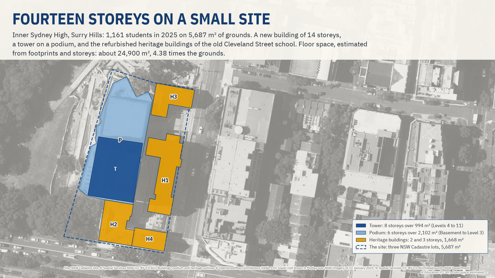
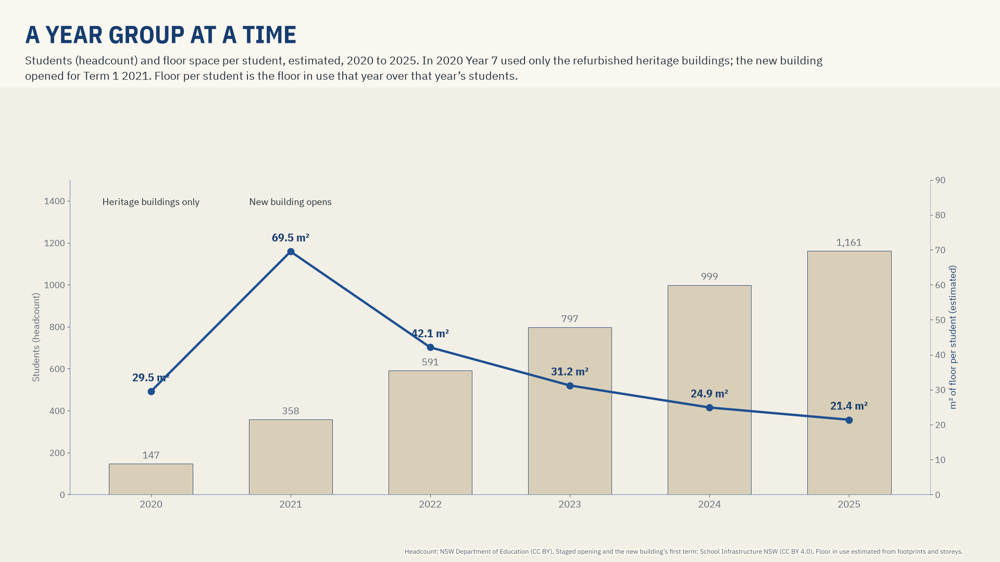

# Inner Sydney High, a deep dive

**The question: why is Inner Sydney High the exception in a land analysis, and how much floor space does each student have?**
**Live version, with an interactive map:** [getplotlay.com/showcase/inner-sydney-high](https://www.getplotlay.com/showcase/inner-sydney-high/)



Inner Sydney High School stands on 5,687 m² of grounds in Surry Hills, Sydney: a 14-storey new building, a tower on a podium, and the refurbished heritage buildings of the old Cleveland Street school. It opened in 2020 with Year 7 and added a year group each year; 2025 is its first year with Years 7 to 12 (1,161 students, headcount, for a school built for up to 1,200).

Measured by land, as the [Sydney schools showcase](https://www.getplotlay.com/showcase/sydney-schools/) does for 81 schools, it has 4.9 m² of grounds per student in 2025, where the median compared high school there has 34.7 m². That difference says how the school was built, not how much room its students have, so the land analysis leaves it out of its medians and rankings. Here it is measured by **floor space, estimated in [Plotlay](https://www.getplotlay.com) from each building's footprint and storeys: about 24,900 m², 21.4 m² per student in 2025.**

[](https://app.plotlay.io/?example=inner-sydney-high&as=client)

## What the data says

| | |
|---|---|
| Grounds (three NSW Cadastre lots) | 5,687 m² |
| Students (headcount), 2020 to 2025 | 147, 358, 591, 797, 999, 1,161 |
| Floor space, estimated (footprint × storeys) | 24,892 m², 4.38 times the grounds |
| Floor space per student, 2025 (estimated) | 21.4 m² |
| Approved gross floor area, SSD 7610 (quoted) | 18,154 m² with covered terraces, 12,616 m² enclosed |
| Per student, 2025, by the approved floor area | 15.6 m² with covered terraces, 10.9 m² enclosed |

| Building | Footprint | Storeys | Floor space (estimated) | Outline from |
|---|---|---|---|---|
| H1: Heritage building 1 | 653 m² | 3 (3 storeys (OpenStreetMap)) | 1,960 m² | OpenStreetMap |
| H2: Heritage building 2 | 449 m² | 2 (2 storeys (OpenStreetMap)) | 898 m² | OpenStreetMap |
| H3: Heritage building 3 | 341 m² | 3 (3 storeys (OpenStreetMap)) | 1,022 m² | OpenStreetMap |
| H4: Heritage building 4 | 226 m² | 2 (2 storeys (OpenStreetMap)) | 451 m² | OpenStreetMap |
| P: New building, podium | 2,102 m² | 6 (Basement, Lower Ground, Ground, Levels 1 to 3) | 12,613 m² | OpenStreetMap |
| T: New building, tower | 994 m² | 8 (Levels 4 to 11 (Level 4 mostly an open games terrace)) | 7,948 m² | drawn over NSW Imagery, 22 January 2021 |

- **A year group at a time.** In 2020 Year 7 used only the refurbished heritage buildings (4,331 m², estimated); the new building opened for Term 1 2021 (School Infrastructure NSW). Floor space per student, the floor in use each year over that year's headcount: 2020 29.5 m², 2021 69.5 m², 2022 42.1 m², 2023 31.2 m², 2024 24.9 m², 2025 21.4 m². At the 1,200 students it was built for it would be about 20.7 m².
- **The estimate and the plans.** The approved gross floor area leaves out stairs, lifts, plant rooms and walls and counts covered outdoor terraces in a line of their own. The estimate counts every storey over each footprint, the open undercroft and terraces included, so it is 1.37 times the approved total. For the heritage buildings alone it is 1.27 times the approved figure.
- **Not a ranking.** Many schools have buildings of several storeys. Floor space here measures this school only and is not compared with any other.



### Read it carefully

- **Floor space is an estimate**: footprint times storeys for each building. The new building is two shapes: the podium (the OpenStreetMap outline of the whole building at ground level) for Basement to Level 3, and the tower (its roof outline, drawn over the NSW aerial photo of 22 January 2021) for Levels 4 to 11. That is 14 storeys, as School Infrastructure NSW counts them. The heritage buildings take their storeys from OpenStreetMap.
- **The tower's footprint is approximate.** An aerial photo shows a tall building's roof a little displaced from its base. Each 100 m² of tower footprint moves the estimate by 800 m².
- **Storeys differ by source**: 14 (School Infrastructure NSW), 13 plus a basement and the rooftop court (the development consent), 14 above ground and 2 below (OpenStreetMap). This repository uses 14, Basement to Level 11, as SINSW's January 2021 welcome pack lists the levels.
- **Heights** (3D only): the new building from the approved design levels above Cleveland Street; the heritage buildings estimated at 4 m a storey. No LiDAR was used: the open NSW elevation services give ground only, and the LiDAR is supplied by order.
- **Students** are the department's headcount, not full-time equivalent, and not capacity.
- **Areas are approximate**: accuracy depends on the cadastre, the OpenStreetMap outlines and the aerial photo the shapes came from.

## The site through time

Openly licensed pictures of the site, used for the inset on the map that follows the year. No openly licensed picture of the site was found for 2006, 2008, 2010, 2011, 2013 to 2019 (the whole build) or 2022 to 2025. The NSW historical aerial photos of 2004 and 2005 are left out because their licence is not stated.

| Date | What | Credit and licence |
|---|---|---|
| c. 1880 to 1890 | Cleveland Street Public School from the street | [Henry King, State Library of NSW](https://commons.wikimedia.org/wiki/File:Cleveland_St_Public_School_ca_1880-1890.jpg), [CC0 1.0](https://creativecommons.org/publicdomain/zero/1.0/) |
| 28 July 2007 | Cleveland Street High School, before the new school | [J Bar](https://commons.wikimedia.org/wiki/File:Cleveland_Street_High_School.JPG), [CC BY 2.5](https://creativecommons.org/licenses/by/2.5/) |
| December 2009 | The heritage buildings from Cleveland Street | [Adam.J.W.C.](https://commons.wikimedia.org/wiki/File:Cleveland_st_boys_high_sydney.jpg), [CC BY-SA 2.5](https://creativecommons.org/licenses/by-sa/2.5/) |
| 7 February 2012 | The heritage buildings from the Cleveland and Chalmers corner | [Maksym Kozlenko](https://commons.wikimedia.org/wiki/File:Surry_Hills_NSW_2010,_Australia_-_panoramio_(8).jpg), [CC BY-SA 3.0](https://creativecommons.org/licenses/by-sa/3.0/) |
| 25 February 2020 | A refurbished heritage doorway, the month Year 7 started; building works at the right edge | [Sardaka](https://commons.wikimedia.org/wiki/File:Cleveland_Street_High_School_007.jpg), [CC BY-SA 4.0](https://creativecommons.org/licenses/by-sa/4.0/) |
| 22 January 2021 | From above: the tower finished, the park side still being landscaped | [NSW Imagery, © Spatial Services, extracted 8 November 2026](https://maps.six.nsw.gov.au/arcgis/rest/services/public/NSW_Imagery/MapServer), [CC BY 3.0 AU](https://creativecommons.org/licenses/by/3.0/au/) |

The pictures are in [`visuals/photos/`](visuals/photos), cropped and resized only. Each keeps its own licence; the share-alike (CC BY-SA) pictures stay under theirs.

## How it was made with Plotlay

1. **A map project** on the NSW aerial imagery, and two **Data layers**: School site and Buildings.
2. **Pick the lots.** Land lots: a click on each of the school's three NSW Cadastre lots joins them into one shape, keyed 8913.
3. **Link the tables** to the site: the headcount for 2020 to 2025 and the floor in use each year.
4. **The buildings.** The tower's roof drawn over the aerial photo; the podium and heritage buildings picked from an OpenStreetMap layer with its licence; keyed P, T and H1 to H4, with the buildings table linked.
5. **A formula column** for the floor space: `round(area_m2 * storeys)`.
6. **3D**: each building at its height in floor plates.
7. **Roll up** the buildings to the site.
8. **Colour** the site by m² of floor (estimated) per student, the floor in use over each year's headcount, on the time slider.
9. **Export** GeoJSON, TopoJSON for the Power BI Shape Map, CSV with WKT, the linked data and a Python starter.

## What's here

| Folder | What |
|---|---|
| [`data/geometry/`](data/geometry) | The site (`school_site.*`, CC BY 4.0) and the buildings (`buildings.*`, **ODbL 1.0**) from Plotlay: GeoJSON, TopoJSON, CSV with WKT |
| [`data/site/`](data/site) | Headcount by year, the floor in use each year, the site rolled up |
| [`data/buildings/`](data/buildings) | One row per building: storeys, heights and their source, the year in use, footprint and floor space (estimated) |
| [`data/planning/`](data/planning) | The approved floor areas, quoted from SSD 7610 with their source |
| [`python/`](python) | A narrated notebook that recomputes every number: [`inner_sydney_high_floor_space.ipynb`](python/inner_sydney_high_floor_space.ipynb) |
| [`powerbi/`](powerbi) | A Power BI Project (`.pbip`). Start with [`powerbi/OPEN-ME.md`](powerbi/OPEN-ME.md) |
| [`visuals/`](visuals) | The charts, the 3D view and the dated pictures |

### Run the notebook

```
python3 -m venv .venv
.venv/bin/pip install -r python/requirements.txt
cd python && ../.venv/bin/jupyter lab inner_sydney_high_floor_space.ipynb
```

## The other schools showcases

- [Sydney schools](https://www.getplotlay.com/showcase/sydney-schools/): grounds per student across 81 inner Sydney and Parramatta government schools (2025 headcount), where Inner Sydney High is the vertical-school exception.
- [NSW and SA schools side by side](https://www.getplotlay.com/showcase/schools-nsw-sa/): the same grounds method within 7 km of the Sydney and Adelaide town halls (2024 students), plus spending, staffing and outcomes.
- [One school campus, building by building](https://www.getplotlay.com/showcase/school-campus/): University High in Parkville drawn as its buildings and rolled up to the site, with estimated floor space.

## Sources and licences

- **Code** (notebook, Power BI project): MIT, see [`LICENSE`](LICENSE).
- **Our tables** (data/site, data/buildings, data/planning, the site outline): CC BY 4.0, see [`LICENSE-DATA`](LICENSE-DATA). Credit "Plotlay (getplotlay.com)" and the sources below.
- **The buildings layer** (data/geometry/buildings.*) is made from OpenStreetMap outlines and is shared under the Open Database Licence 1.0 (https://opendatacommons.org/licenses/odbl/1-0/), © OpenStreetMap contributors.
- Headcounts: NSW Department of Education (Centre for Education Statistics and Evaluation), data.nsw.gov.au, CC BY.
- Cadastre and aerial imagery: © State of New South Wales (Spatial Services), CC BY 3.0 AU.
- School Infrastructure NSW (storeys, the staged opening, the first term of the new building): © State of New South Wales (Department of Education), CC BY 4.0.
- NSW Planning Portal, SSD 7610 (approved floor areas, design levels, capacity): figures quoted with their source; the documents are not included.
- Pictures: each with its own credit and licence in the table above.

This is independent work using open data. It is not endorsed by the NSW Department of Education, School Infrastructure NSW, Spatial Services or the school. Full credits are in [`NOTICE`](NOTICE).
